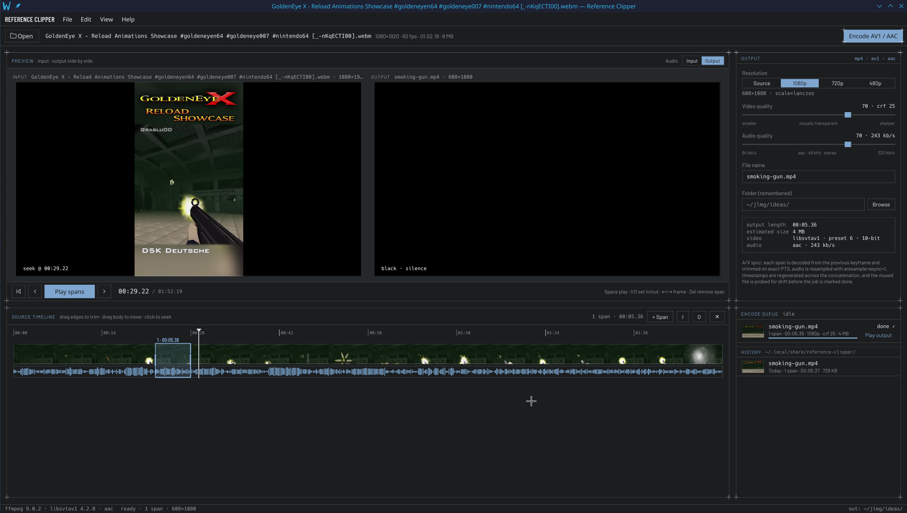

<p align="center">
  
</p>

<h1 align="center">Reference Clipper</h1>

<p align="center">
  <strong>Mark the spans. Encode them in order. Keep picture and sound on the same clock.</strong>
</p>

<p align="center">
  A Linux desktop app for cutting a video down to the parts you want<br>
  and writing them, back to back, as one AV1 + AAC MP4.
</p>

<p align="center">
  
  
  
  
</p>

Open a file. Draw one or more spans on the source timeline. Encode. The output is a single MP4: 10-bit AV1 from libsvtav1, AAC at 48 kHz stereo, and a measured drift figure before the job is allowed to say it is done.

Before that encode exists, the right-hand pane is a seek preview of the source at the output resolution. After it exists, the same pane decodes the file you just wrote, so you are looking at the frames that landed on disk.

## The window

The screenshot above is the default layout. Four panels cover the whole job.

| Panel | What it is for |
| --- | --- |
| **Preview** | Source frame and output frame, side by side. Playback walks the spans and skips the gaps. |
| **Source timeline** | Filmstrip, waveform, and the spans themselves. Drag an edge to trim, drag the body to move, click empty track to seek. |
| **Output** | Resolution, video quality, audio quality, file name, and the folder the app remembers. The plate under the sliders is a live size estimate. |
| **Queue** | One encode at a time. Finished jobs stay in history and reopen the source they came from. |

View → Layout also offers a three-column arrangement and a stacked one. The theme follows the desktop, with an explicit light or dark override.

## A cut that stays in sync

Video is the master timeline. Each span is snapped to the real frames inside it, so its output length is a whole number of source ticks. Audio is then cut to that same length, counted in source-rate samples, and the two streams are muxed together.

The trim follows packet timestamps. Decoding starts at the keyframe before the in-point and drops every frame that falls outside the span. Audio priming packets, which sit before time zero, are kept so the first real samples are not lost. After the file is written, both streams are probed and the job fails if they disagree by more than one frame. The toast on a good encode reports the drift in milliseconds.

Spans are half-open: the in-point is kept, the out-point is not. Overlaps are allowed. A region covered twice appears twice, in the file and in playback.

A finished output drives the preview only while the spans still match it. Edit a span and the pane returns to seek preview.

## Marking spans

| | |
| --- | --- |
| `Space` | Play or pause the spans |
| `I` / `O` | Set the selected span's in-point or out-point at the playhead |
| `←` / `→` | Step one frame |
| `Delete` | Remove the selected span |
| `+ Span` | Add a span at the playhead |
| `Ctrl+O` | Open a file |
| `Ctrl+W` | Close the clip |
| `Ctrl+Q` | Quit |

Keys are ignored while a text field has focus.

A clip opens with no spans. Add one, or set an in and an out. The playhead outside every span shows black on the output side, and silence when you are listening to the output.

## Encode

**Encode AV1 / AAC** queues the current spans and settings. Resolution is Source, 1080p, 720p, or 480p, scaled with Lanczos to even dimensions. Video quality and audio quality are sliders from 0 to 100; the defaults are 70, which is CRF 25 and 243 kb/s. The encoder runs libsvtav1 at preset 6, 10-bit 4:2:0.

Jobs write `<output>.part` and rename into place on success. A failed or cancelled job leaves nothing at the destination. Replacing an existing file asks first, and so does quitting while an encode is running.

## Opening a clip

Any of these:

- Drop a file on the window
- Pick one from the gallery of `~/Videos`
- File → Open, or the toolbar button
- File → Open Recent
- A row in History
- `reference-clipper path/to/video.mkv`
- A file association for MP4, Matroska, WebM, and QuickTime

The gallery also lists `.m4v` and `.avi`.

## Build

Qt 6.8 or newer, the FFmpeg libraries (`libavformat`, `libavcodec`, `libavfilter`, `libswresample`, `libswscale`, `libavutil`) with `libsvtav1`, `libpulse-simple`, CMake 3.28, and Ninja. Developed against FFmpeg 9 and SVT-AV1 4.2. Tests also need the `ffmpeg` command-line tool, built with `libx264`, to generate fixtures.

```sh
cmake --preset release && cmake --build --preset release
./build-release/reference-clipper
```

The `dev` preset is Debug with ASan and UBSan, and it is what the tests expect:

```sh
cmake --preset dev && cmake --build --preset dev
ctest --preset dev
```

Install the binary, the `.desktop` file, and the icon with `cmake --install build-release`.

Config lives in `~/.config/reference-clipper/`. History, including a thumbnail for each job, lives in `~/.local/share/reference-clipper/`.

## License

The UI is set in [Barlow](https://fonts.google.com/specimen/Barlow), which is distributed under the SIL Open Font License. See `assets/fonts/OFL.txt`.
